# ICARUS: is AI a bubble, and when does it burst?

[](https://github.com/vikwillberg/Predicting-the-AI-Bubble/actions/workflows/pipeline.yml)
[](https://github.com/vikwillberg/Predicting-the-AI-Bubble/actions/workflows/ci.yml)
   

ICARUS is an early-warning system for the AI bubble. Every week a GitHub Action scrapes market, macro,
fundamental and attention data from six public sources and rebuilds a DuckDB feature warehouse in SQL.
It then reruns seven independent models and publishes a probability that the AI trade crashes, with a
timeline and an uncertainty band. The crash model is trained on 67 assets going back to 1927 (the
dot-com bust, Japan 1989, Shanghai 2007 and 2015, oil 2008, bitcoin, ARK) and validated walk-forward,
so every backtest number below is out of sample.

> Named after the boy who flew too close to the sun: the question is never *whether* wax melts, only how hot it is and how long until it does.

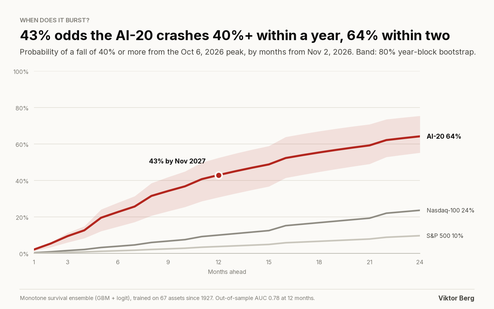

## The answer, updated every week

<!-- RESULTS:START -->
*Auto-generated by the pipeline from `reports/results.json`. Data as of **2026-11-02**.*

| Question | ICARUS answer |
|---|---|
| Is AI in a bubble? | **Yes**: Bubble Risk Index **81/100** (range 76-89 under random pillar weights); PSY test finds explosive growth in ^NDX since 2023 |
| Where are we? | **Deflating**: AI-20 peaked 2026-10-06, now 19.7% below; HMM regime **stress** (83%); 15 of 20 members in bear markets |
| P(AI-20 falls 40%+ within 12 months) | **43%** (80% CI 31%-52%) |
| P(AI-20 falls 40%+ within 24 months) | **64%** (80% CI 55%-75%) |
| When? | Most likely burst month **2027-04**; median, if it bursts within 24 months: **2027-08**; dot-com clock equivalent: 2027-07-19 |
| P(Nasdaq-100 bear market, -20%, within 12 months) | 59% |
| P(S&P 500 bear market, -20%, within 12 months) | 26% |
| LPPLS bubble clock (ex-ante) | On 2026-10-02 it put the critical time at **2026-10-02**; the AI-20 peaked **2026-10-06** (-4 days) |
| Capex strain | Hyperscalers spent **1.16x** their operating cash flow on capex last quarter; 4 of 5 spent more than they generated |
| Anthropic IPO at $1.5T | Requires ~**$802B** revenue by 2036 (80% range $585-1123B) |
| Model skill (out of sample) | 12-month AUC **0.78**, Brier skill **+22%** vs base rate |

<!-- RESULTS:END -->

**Definitions.** The *AI-20* is an equal-weight, total-return basket of 20 companies across the AI stack:
chips (NVIDIA, Broadcom, AMD, TSMC, ASML, Micron, Arm), cloud (Microsoft, Alphabet, Amazon, Meta, Oracle,
CoreWeave), infrastructure (Arista, Super Micro, Dell), power (Vertiv, Constellation, Vistra) and
applications (Palantir). A *burst* is a fall of 40% or more from the running peak, the crash definition
from Greenwood, Shleifer & You (2019, *Bubbles for Fama*). A *bear market* is a 20% fall.

## What the launch analysis found (data to Nov 2, 2026)

1. **The AI trade peaked on Oct 6, 2026, and it is cracking from the inside.** The AI-20 is 20% below its
   high, but the median member is down 31%, and 15 of the 20 are in bear markets: CoreWeave -73%,
   Oracle -63%, Arm -55%. Microsoft (-7%) and NVIDIA (-16%) are holding up. Narrow leadership over
   collapsing breadth is the pattern of early 2000.
2. **Bubble or not, the statistics say "explosive".** The Phillips-Shi-Yu test rejects a random walk for the
   Nasdaq-100 and dates explosive regimes in 1997-2000, 2020-22 and again from late 2023 to today. Sornette's
   LPPLS bubble clock, fitted on Oct 2, put the critical time at Oct 2 (range Sept 21 to Oct 12): the bubble
   was at its breaking point. The AI-20 topped four days later.
3. **The money is under strain.** In Q3 2026 the five hyperscalers spent $230B on capex against $199B of
   operating cash flow (1.16x, up from 0.41x in 2023), and four of the five spent more than they generated.
   At NVIDIA's ~$385B revenue run-rate, Sequoia's "$600B question" is now a $1.4T question: the end-user AI
   revenue needed to earn a return on the build-out, against ~$105B for Anthropic and OpenAI combined.
4. **The Anthropic IPO prices in a lot.** At the reported $1.5T target, a reverse DCF says Anthropic needs
   about $800B of revenue by 2036 (a 30% annual growth rate for ten years). That is more than Amazon's
   revenue today. Its revenue did grow 14x year on year in the first half of 2026, per press coverage of its S-1.
5. **It is not 2000 on every measure.** The Nasdaq-100 is up 2.3x since ChatGPT; it was up 8.2x from the
   Netscape IPO to its 2000 peak. The AI-20 trades at 23x trailing earnings, while the 2000 leaders often
   traded above 100x. And cross-sector coupling (the absorption ratio) is near its lowest since 2001, so this
   looks like an AI-specific deflation, not a systemic crisis.

**Bottom line:** the model gives a 42% chance that the AI-20 falls 40% from its October peak within a year
(80% range 30-52%), and 63% within two. That is about twice the 20% base rate across the training panel, and
in line with what the same model said at the top of the Nasdaq in 2000 (29%), NVIDIA in 2021 (43%) and ARK
in 2021 (64%).

## Seven perspectives

| Perspective | Method | Question it answers |
|---|---|---|
| **Crash odds and timing** | Monotone multi-horizon survival ensemble (LightGBM with a monotone constraint on the horizon, blended with L2 logistic regression; blend weight learned walk-forward) | P(-40% within k months) for k = 1..24 |
| **Explosiveness** | Phillips-Shi-Yu GSADF / BSADF with Monte Carlo critical values; O(1) prefix-sum ADF windows | Is price growth statistically explosive, and since when? |
| **Bubble clock** | LPPLS (Johansen-Ledoit-Sornette; Filimonov-Sornette reformulation), multi-scale confidence indicator, parallel Go engine | When is the critical time? |
| **Regimes** | 3-state Gaussian hidden Markov model on 40 years of weekly Nasdaq-100 returns and volatility | Calm, choppy or stress, and for how long? |
| **History** | Time-stretched shape matching against 12 famous bubbles; dot-com calendar clock | If this is a bubble, which month of it are we in? |
| **Fundamentals** | Hyperscaler capex vs cash flow, NVIDIA cash conversion, Sequoia's AI revenue gap, Anthropic reverse DCF (20,000 draws) | Is the money real? |
| **Fragility** | Bubble Risk Index from 7 pillars: price, valuation (CAPE since 1871), fundamentals, market structure (breadth, concentration, Kritzman absorption ratio), credit and macro (FRED), AI hype (Wikipedia, GDELT), mega-IPO issuance | How bubble-like is the whole picture? |

## Figures

| | |
|---|---|
| 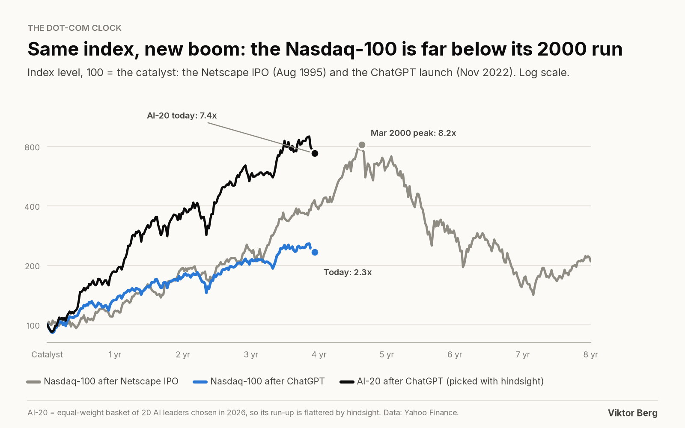 | 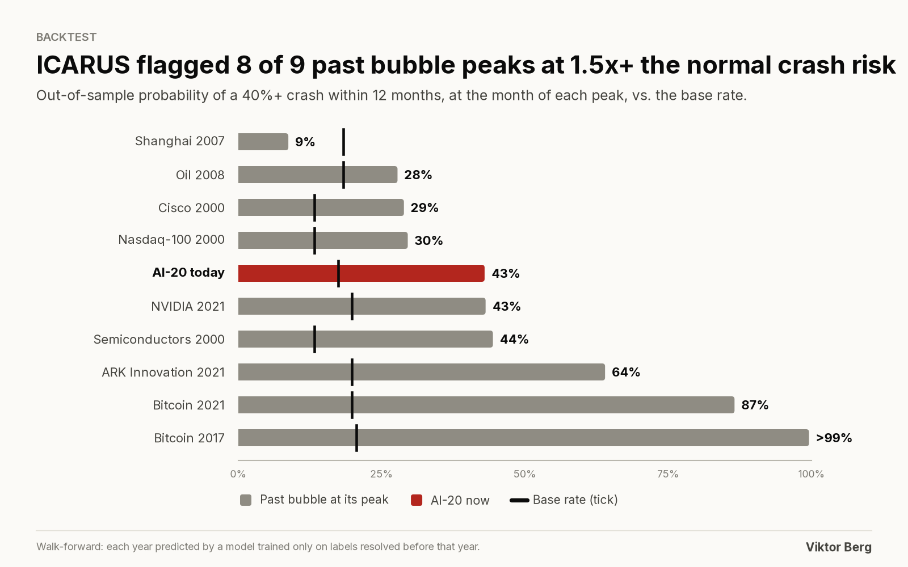 |
| 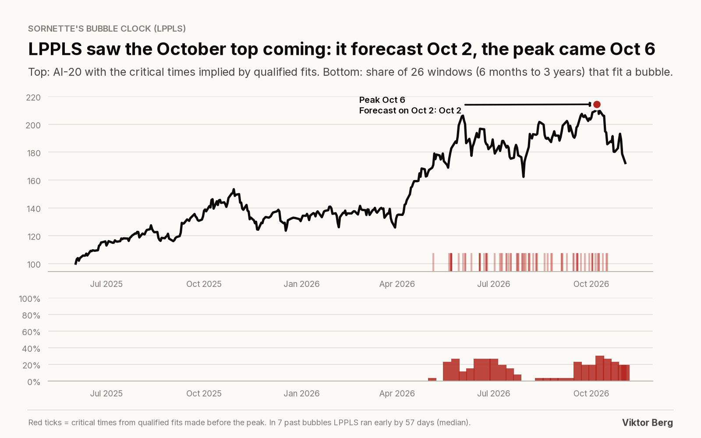 | 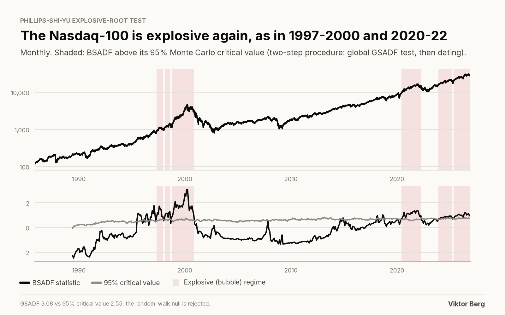 |
| 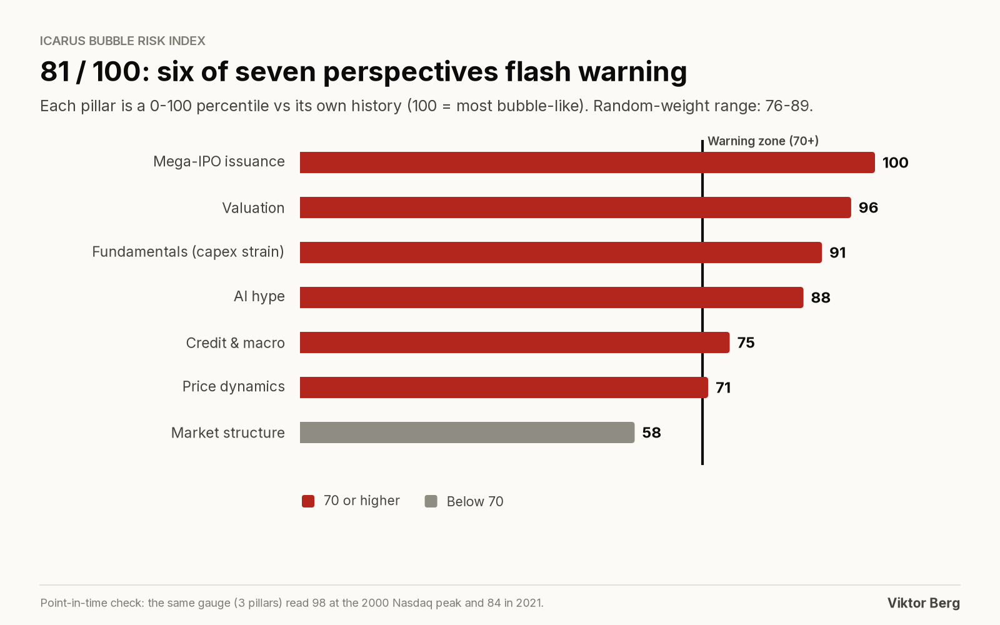 | 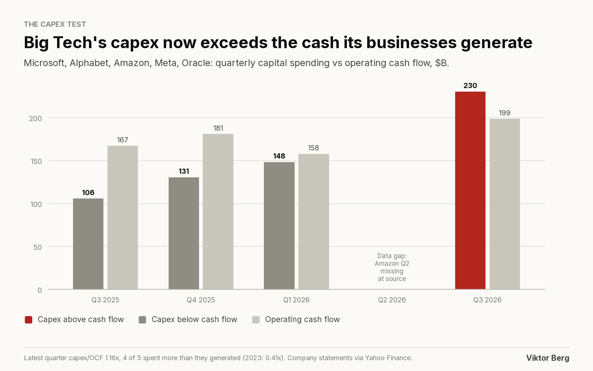 |
| 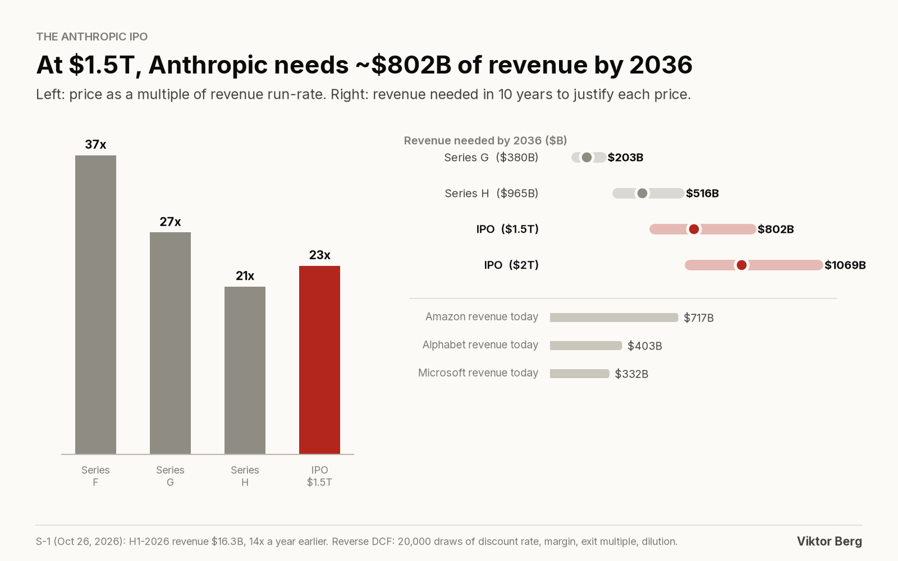 | 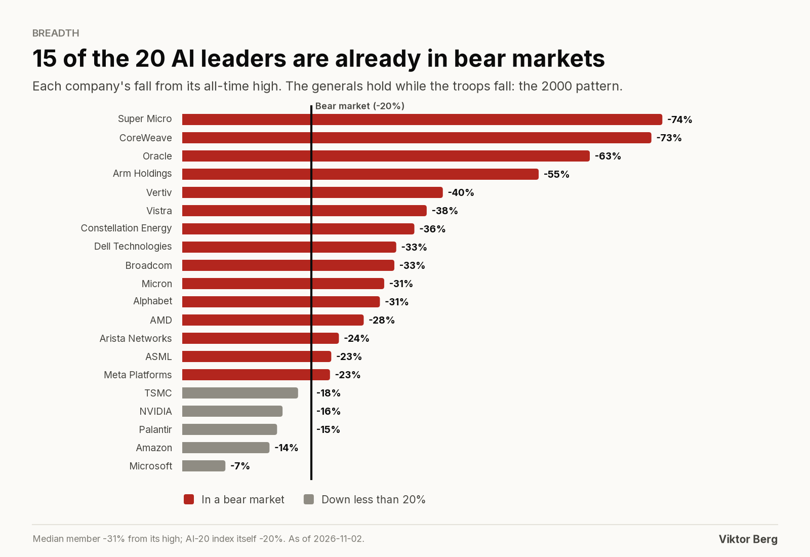 |
| 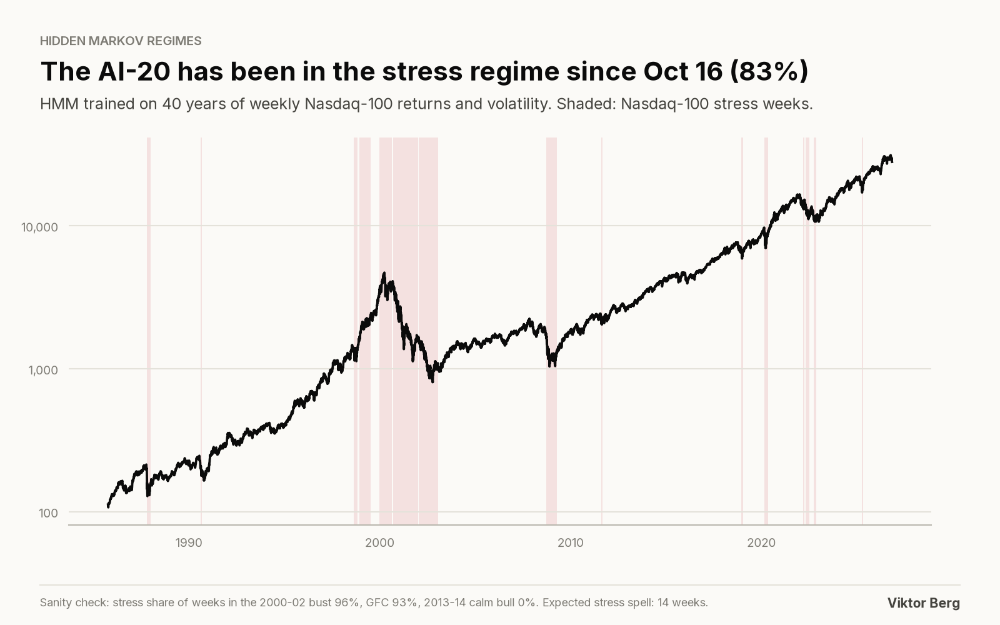 | 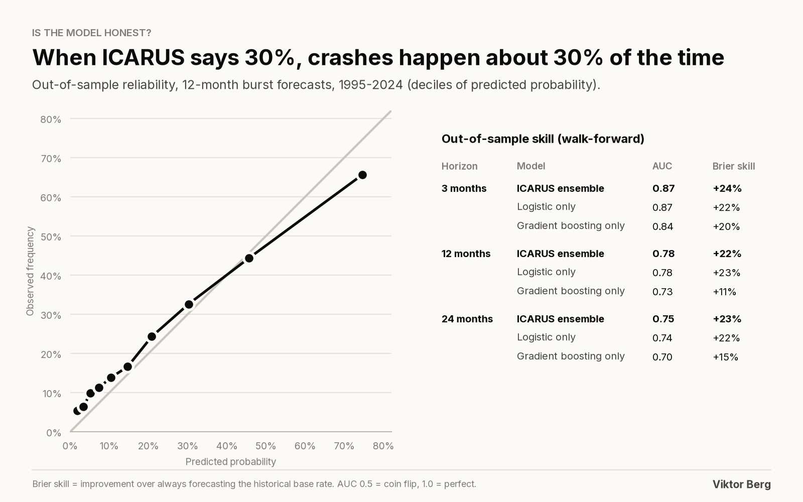 |

An interactive version lives in [`docs/index.html`](docs/index.html). To serve it, enable GitHub Pages once:
*Settings → Pages → Deploy from a branch → `main` / `docs`*.

## How it works

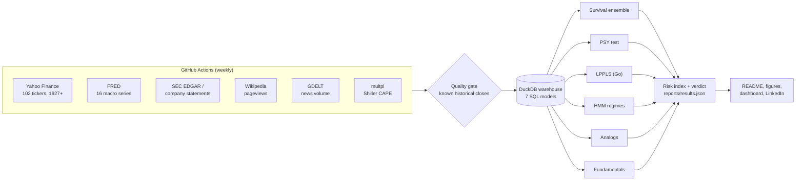

**Languages, each where it fits:** Python for modelling, SQL (DuckDB) for the feature warehouse, Go for the
compute-heavy LPPLS scanner, JavaScript for the dashboard, YAML for CI/CD.

- `sql/03_drawdowns_events.sql` labels every crash in 100 years of data with window functions: running
  peaks, drawdown episodes, and the next bear/burst event after each day.
- `sql/04_features.sql` builds 20 features per asset-month with calendar-time `RANGE ... INTERVAL` windows,
  so 7-day crypto and 5-day stock markets are treated alike.
- `sql/06_fundamentals.sql` rebuilds discrete quarters from year-to-date 10-Q cash flows (Q2 = 6M - 3M ...)
  across fiscal calendars that end in January (NVIDIA), May (Oracle) and June (Microsoft).
- `engine/` fits LPPLS windows on every CPU core: a deterministic grid search plus Nelder-Mead, with the
  linear parameters solved exactly. The Python reference in `icarus/models/lppls.py` runs the identical
  algorithm, and a test asserts both engines return the same fits.

## How I double-checked it

Every claim in this README traces to a test, a backtest or a cross-check against independent reporting.

| Check | Result |
|---|---|
| Scraped prices vs eight famous closes (Black Monday 1987, Nasdaq 2000 peak, 2009 low, Nikkei 1989 ...) | All match to the cent; the pipeline stops if one is off by more than 0.5% |
| Hyperscaler Q3 2026 capex from scraped statements vs press reports | $202B (Amazon + Alphabet + Microsoft + Meta) vs ~$203B reported |
| NVIDIA price and record high vs news | $239.24 record close on Oct 6, ~$208 on Nov 2-3: matches coverage |
| Nasdaq Composite, October 2026, vs CNN | -5.30% for the month and -7.84% below the Oct 6 record (CNN: -5.3%, -7.8%); Intel's -28.6% day (reported -28.58%) |
| Walk-forward backtest, 1995-2024 (no look-ahead) | 12-month AUC 0.78, Brier skill +22% vs base rate; calibration within ~2 points |
| Famous bubbles, out of sample | Flagged 8 of 9 peaks at 1.5x+ normal risk; missed Shanghai 2007 |
| LPPLS on 7 historical bubbles | Confidence rose before every peak; critical time 3-11 weeks early (median 57 days) |
| PSY test size on pure random walks | 5.2% false-alarm rate per date at the 5% level (correct); two-step dating keeps false episodes rare |
| HMM sanity check | Stress regime covers 96% of the 2000-02 bust, 93% of the GFC, 0% of the calm 2013-14 bull |
| LPPLS Go vs Python | Identical fits on synthetic bubbles (critical time within 0.5 day) |

**Bugs the double-checking caught (and what changed):**
- *The rebound trap.* An asset that fell 30% and bounced back to -19% was labelled as "not yet in a bear
  market", which taught the model that deep drawdowns are safe. Labels now track the worst drawdown of
  each episode (`episode_worst_dd`), and a SQL test pins the case.
- *Calibration that hurt.* A Platt-scaling step looked good in-sample but worsened out-of-sample scores, so
  it was removed in favour of a walk-forward-learned blend of the two models.
- *Hindsight.* The AI-20 is chosen with 2026 knowledge, so it is never used for training, and the dot-com
  comparison is made Nasdaq-100 to Nasdaq-100.

## Limitations

- A probability is not a date: a 42% chance within a year is a 58% chance of no burst within a year.
- Yahoo only carries survivors (no Pets.com, Lucent, Nortel), which biases single-stock crash rates down.
- Panel samples overlap in time, so the effective sample is closer to the ~190 burst events than to the 74k rows.
- Anthropic and OpenAI figures come from press coverage of filings and funding rounds; each has a source
  and a confidence level in [`config/private_marks.yaml`](config/private_marks.yaml). SEC EDGAR blocks
  anonymous scrapers, so company statements come from Yahoo until `SEC_USER_AGENT` is set (see below).
- Nothing here is investment advice.

## Run it yourself

```bash
pip install -r requirements.txt
```

```bash
(cd engine && go build -o ../bin/lppls ./cmd/lppls)   # optional: falls back to Python without it
```

```bash
python -m icarus ingest      # scrape everything into data/raw/
```

```bash
python -m icarus validate    # data-quality gate
```

```bash
python -m icarus all         # SQL warehouse -> models -> figures, README block, dashboard
```

```bash
python -m pytest -q          # 23 tests: synthetic ground truth, SQL edge cases, engine parity
```

`make all` runs the same steps. To collect 15+ years of quarterly fundamentals from SEC EDGAR instead of
Yahoo's last five quarters, add a repository variable `SEC_USER_AGENT` such as `Your Name you@example.com`
(SEC requires a contact address in the User-Agent).

## Repository map

```
config/            universe, model settings, curated private-market marks with sources
icarus/ingest/     scrapers: Yahoo, FRED, SEC EDGAR, Wikipedia, GDELT, multpl
icarus/warehouse/  DuckDB builder (runs sql/*.sql)
sql/               the feature warehouse: staging, AI-20 index, crash labels, features, fundamentals
icarus/models/     survival ensemble, PSY, LPPLS, HMM, systemic risk, analogs, fundamentals, risk index
engine/            Go LPPLS engine (parallel)
icarus/report/     figures, dashboard, README block, LinkedIn carousel
docs/              GitHub Pages dashboard + methodology + model card
linkedin/          4-slide carousel, PDF, data workbook, post text
tests/             pytest suite (Go tests live in engine/)
```

Read more: [methodology](docs/METHODOLOGY.md) · [model card](docs/MODEL_CARD.md).

## References

Phillips, Shi & Yu (2015), *Testing for Multiple Bubbles*, IER · Johansen, Ledoit & Sornette (2000),
*Crashes as Critical Points*, IJTAF · Filimonov & Sornette (2013), *A stable and robust calibration scheme of
the log-periodic power law model*, Physica A · Sornette et al. (2015), *Real-time prediction and post-mortem
analysis of the Shanghai 2015 stock market bubble and crash* · Greenwood, Shleifer & You (2019), *Bubbles for
Fama*, JFE · Kritzman, Li, Page & Rigobon (2011), *Principal Components as a Measure of Systemic Risk*, JPM ·
Cahn (2024), *AI's $600B Question*, Sequoia Capital.

---

Built by **Viktor Berg**. Data: Yahoo Finance, FRED (Federal Reserve Bank of St. Louis), SEC EDGAR, Wikimedia,
GDELT, multpl. Released under the MIT License.
